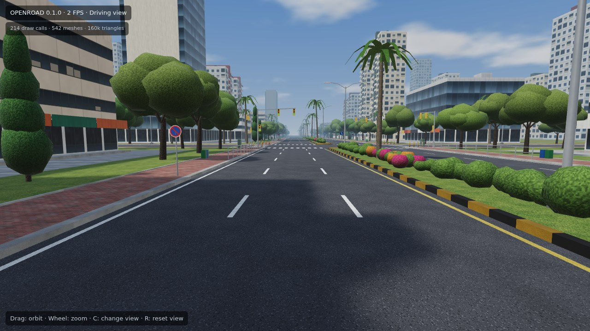

# OPENROAD

A browser-based, multiplayer, open-world driving and social game. The first world is Greater Noida, India.

**Current milestone:** OPENROAD 0.1 — Foundation and 3D scene. The application renders a procedural test district: a divided six-lane road crossing a four-lane road, with footpaths, planting, buildings, street furniture, daylight and shadows. There is no vehicle, physics, multiplayer or backend yet.



## Requirements

- Node.js 22 or newer (npm 10 or newer ships with it)
- A desktop browser with WebGL 2: Chrome or Edge recommended

## Setup

```sh
git clone https://github.com/Rishu123-png/Openroad.git
cd Openroad
npm install
```

## Commands

Run all commands from the repository root.

| Command | What it does |
| --- | --- |
| `npm run dev` | Starts the development server at http://localhost:5173 with live reload |
| `npm run typecheck` | Checks TypeScript types without building |
| `npm test` | Runs the unit tests once |
| `npm run build` | Type-checks, then builds the production bundle into `apps/web/dist` |
| `npm run preview` | Serves the production bundle at http://localhost:4173 |

## Controls

| Input | Action |
| --- | --- |
| Left mouse drag | Orbit the camera |
| Mouse wheel | Zoom |
| C | Glide to the next camera view (driving, footpath, junction, aerial) |
| R | Reset camera view |

W/A/S/D, the arrow keys and Space are already bound to driving actions, but nothing uses them until the vehicle exists.

## Repository layout

```
apps/web/               the browser game (Vite + TypeScript + Babylon.js)
  index.html
  src/
    main.ts             composition root: creates and connects everything
    game/engine/        engine creation and the Game lifecycle
    game/world/         the procedural district: roads, buildings, planting, furniture
    game/geometry/      mesh building and batching
    game/materials/     shared materials and textures generated in code
    game/camera/        camera rig
    game/lighting/      sky, sun, shadows, haze, tone mapping
    utils/              seeded random numbers and noise
    input/              device-independent input actions
    ui/                 DOM overlay and styles
  tests/
docs/                   project documents
```

## Documents

- [Technical architecture](docs/TECHNICAL_ARCHITECTURE.md)
- [World generation and rendering](docs/WORLD_GENERATION.md): how the district is built, performance and visual limitations
- [Project management decisions](docs/PROJECT_MANAGEMENT.md)
- [Session 01 — Foundation and 3D scene](docs/sessions/SESSION_01.md)

## Real-world map data (in progress)

The world shown today is still a fictional test district. Work has started on building Greater Noida from real map data:

- `node tools/fetch-osm.mjs` downloads the baseline OpenStreetMap extract to `data/osm/`; `--profile v2` downloads the expanded one to a separate file.
- `node tools/compare-osm.mjs` compares the two extracts.
- `node tools/build-layers.mjs` converts an extract into game-ready layers in metres; `node tools/render-coverage.mjs` draws them as a 2D coverage map. See [docs/GEODATA_PIPELINE.md](docs/GEODATA_PIPELINE.md).
- `node tools/build-district.mjs` cuts the Alpha 1 district out of those layers for the game, which then shows it in 3D with a drivable vehicle (W/A/S/D, C camera, G garage with two generic vehicles, L headlights, V data views) and light traffic. Without the data the app says how to build it; `?district=synthetic` shows an invented test layout. Rules for what is mapped, estimated and generated: [docs/DISTRICT_RULES.md](docs/DISTRICT_RULES.md). Map data © OpenStreetMap contributors (ODbL).
- `node tools/inspect-osm.mjs` audits the extract (coverage, gaps, building evidence). `npm run test:tools` tests it.
- [docs/GEODATA_SOURCES.md](docs/GEODATA_SOURCES.md): sources, licences, coverage and confidence classes.
- [docs/REGION_PACKAGES.md](docs/REGION_PACKAGES.md): design of downloadable region packages (not implemented).

Map data © OpenStreetMap contributors, available under the Open Database License.
