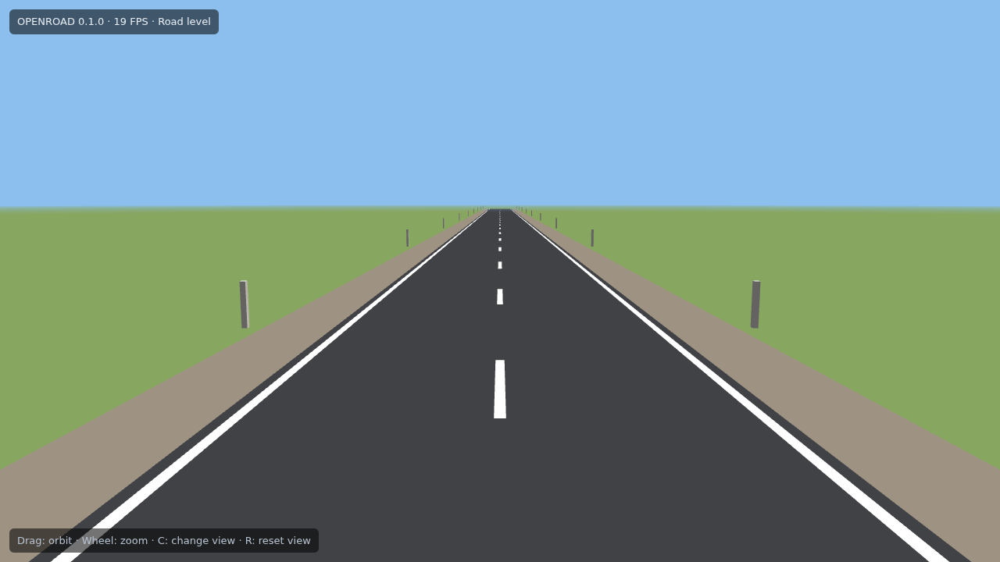
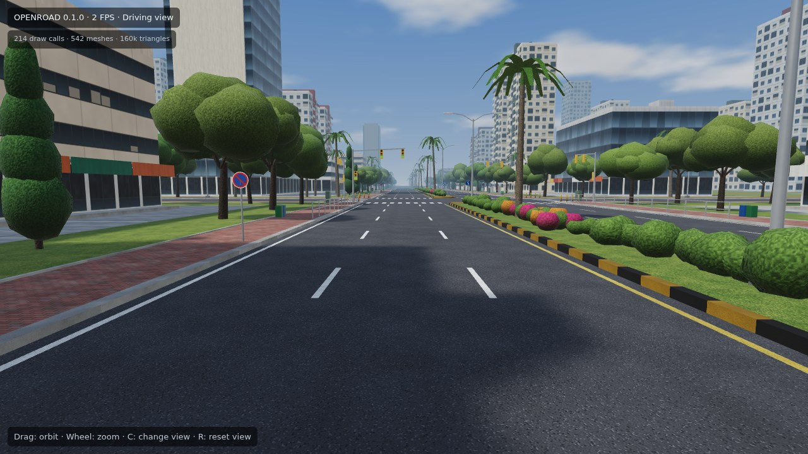
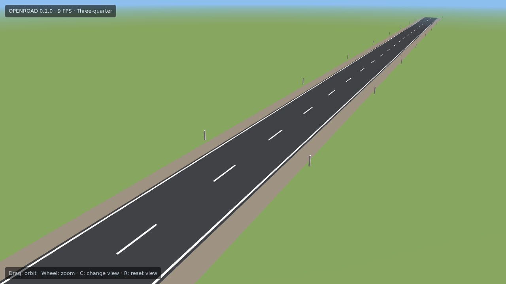
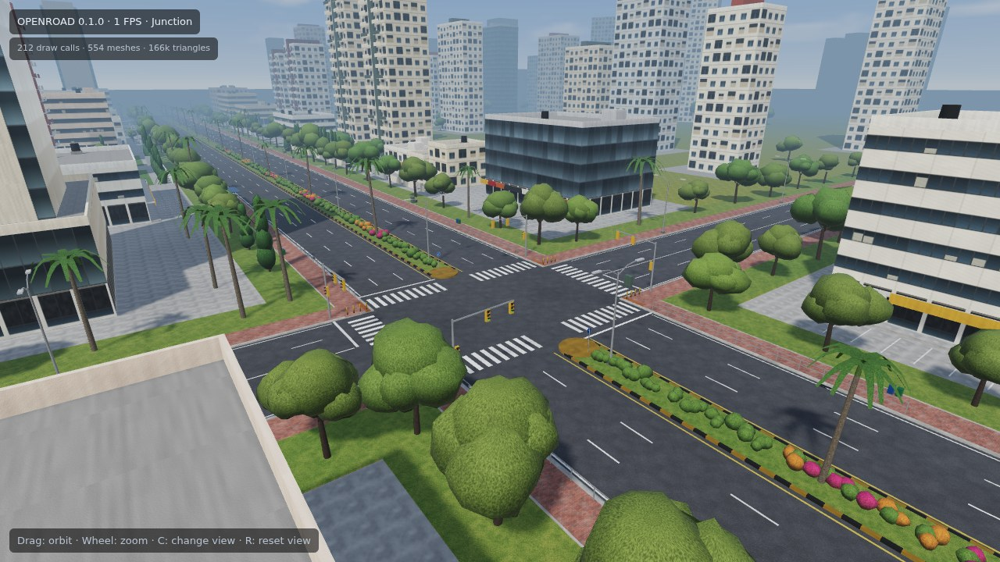
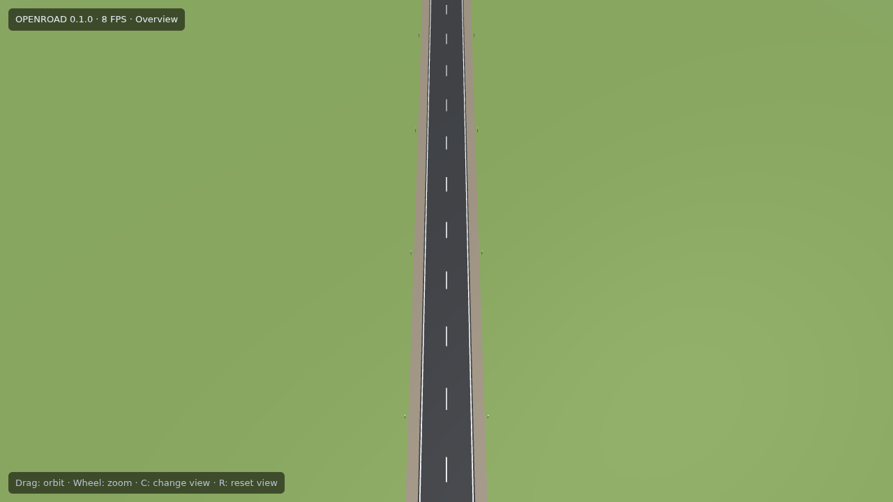
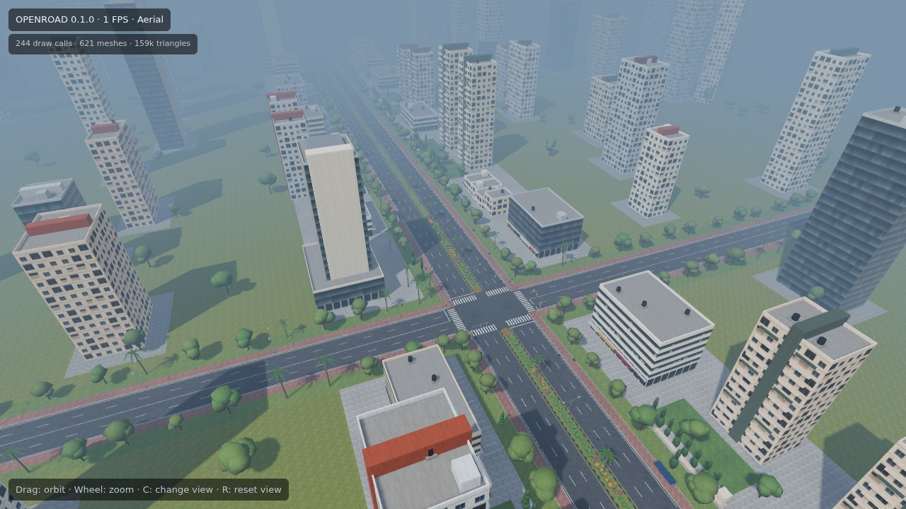

# World generation and rendering

Scope: the procedural test district in OPENROAD 0.1. It is not real map data. It is a stand-in that sets the visual standard and the technical pattern (tiles, batching, shared materials) that the OpenStreetMap pipeline will follow.

## Before and after

| Before | After |
| --- | --- |
|  |  |
|  |  |
|  |  |

Also: [footpath view](screenshots/after-footpath.jpg).

All screenshots were captured from the running application in headless Chromium at 1280 × 720 with a software renderer.

## Why the first scene looked artificial

| Cause | Fix |
| --- | --- |
| Every surface was one flat colour | Procedural textures with normal maps, plus low-frequency colour variation in vertex colours |
| Non-physical materials | Physically based materials with roughness and metalness |
| No shadows | A sun shadow map with soft filtering |
| Sky was one colour, and ambient light was a constant | Sky panorama with gradient, sun glow and clouds; ambient light and reflections derived from the same sky |
| Infinite empty plane with a hard horizon | Buildings in three depth bands, trees, and exponential haze matched to the horizon colour |
| Nothing vertical, so no sense of scale | Kerbs, lamp posts, signals, signs, railings and trees at real dimensions |
| Road was a strip on the ground | Kerbs, footpaths, verges, a raised planted median, drains and a signalised junction |
| No tone mapping | Filmic (ACES) tone mapping with modest contrast |
| Narrow field of view from a high orbit | 58° vertical field of view from driver height |

## The district

Units are metres. The main road runs along Z, the cross road along X, and they meet at the origin. Traffic keeps left.

| Element | Dimensions |
| --- | --- |
| Main road | Two carriageways of three 3.5 m lanes, 4 m planted median |
| Cross road | Four 3.5 m lanes, no median |
| Kerb | 0.3 m wide, 0.15 m high |
| Footpath | 3 m, interlocking pavers, tactile strip at crossings |
| Verge | 6 m, grass and avenue trees |
| Storeys | 3.2 m; ground-floor shops 4 m |
| Lamp posts | 9 m, twin arm, every 36 m in the median |
| Detailed area | 440 m each way along the main road; the road continues to 720 m and fades into haze |

Building types: shop-and-office blocks, glass office towers on podiums, gated housing societies with matching towers, terraces of two- and three-storey houses, free-standing towers behind the street, and a distant skyline.

Indian street character comes from: keep-left markings and stop lines, black-and-yellow painted median kerbs, a flowering median hedge with royal palms, ashoka trees along boundary walls, rooftop water tanks, rolling shutters, gated societies with guard cabins, yellow signal heads and paired litter bins.

## How it is built

```
createWorld(scene, seed)
  createMaterialLibrary      14 shared materials, textures generated in code
  buildRoads                 asphalt, markings, crossings, drains
  buildGroundworks           kerbs, footpaths, verges, median, open land
  buildBuildings             plots, towers, skyline
  buildFurniture             lamp posts, signals, signs, railings, shelters
  plantVegetation            trees and shrubs as instances
  WorldBatcher.build         one mesh per material per 110 m tile
```

| Technique | Where | Effect |
| --- | --- | --- |
| Geometry batching | `geometry/WorldBatcher.ts` | Several thousand boxes and quads become 374 static meshes |
| Ground tiles | 110 m squares | Babylon.js frustum culling skips tiles out of view; the same division suits world streaming later |
| Shared materials with vertex colours | `materials/MaterialLibrary.ts` | Wall colours, kerb paint and road wear vary without new materials |
| Instancing | Trees, shrubs, lamp posts, signals | 992 placed objects from 17 base meshes |
| Level of detail | Trees switch to a simpler mesh at 150 m and disappear at 620 m; shrubs disappear at 240 m | Fewer triangles at distance |
| Static shadow map | `lighting/createDaylight.ts` | Drawn once at start-up, then reused |
| Procedural textures | `materials/proceduralTextures.ts` | No image or model downloads; no licensing questions |
| Sky-derived ambient light | 32-pixel cube map and spherical harmonics computed in code | No HDR environment file |
| Tone mapping in material shaders | Scene image processing | No post-processing pass |
| Seeded random numbers | `utils/random.ts` | The same district on every load, so tests can assert on it |

Texture coordinates are in metres everywhere. A material sets how large its texture is with one scale value, and facade windows line up because building widths are multiples of the 3 m bay and heights are multiples of the 3.2 m storey.

## Performance

Measured in the sandbox with headless Chromium 153 on SwiftShader, a software renderer running on 2 CPU cores. These numbers describe scene complexity. They do not predict frame rate on a GPU.

| Measure | Value |
| --- | --- |
| Draw calls per frame | 202 to 244, depending on view |
| Triangles drawn per frame | 159,000 to 168,000 |
| Meshes after culling | 530 to 621 |
| Materials | 15 |
| Textures | 24. Surface textures total about 16 MB of GPU memory with mip maps; the 4096 × 4096 shadow map adds roughly 64 MB |
| Generated content | 117 buildings, 129 skyline towers, 494 trees, 448 shrubs, 46 lamp posts, 1,222 road markings |
| JavaScript time to submit a frame | About 2 ms |
| Shadow map updates per frame | 0 after start-up |
| Time from page load to first frame | About 2 s, which includes generating every texture |
| Production JavaScript | 1.19 MB entry chunk (297 kB gzipped); shaders load as separate chunks |

Software-renderer frame time at 1280 × 720 was about 1.7 s for the district against 0.06 s for the sky alone, and 2.8 s at 1920 × 1080. Disabling shadows saved about 18%. The old flat scene ran at 8 to 24 FPS in the same software renderer, so the new scene is far heavier per pixel, as expected when moving from flat colours to physically based shading. Whether it holds 60 FPS at 1080p on the RTX 3050 has not been measured and must be checked on the hardware.

If it is too slow on real hardware, the cheapest levers, in order: lower the shadow map from 4096 to 2048, drop normal maps on grass and plaster, render at a lower internal resolution, and sort opaque meshes front to back to cut overdraw.

## Visual limitations

- **Trees** are rounded noisy masses. They read as trees at driving distance but look modelled up close. Real foliage needs alpha-tested leaf cards or authored models.
- **Buildings** are textured boxes with added balconies, parapets and roof clutter. Windows are painted on, with no depth, no interiors and no per-window reflections.
- **Glass** reflects only a smooth sky gradient. There are no reflections of neighbouring buildings.
- **No ambient occlusion**: contact shadows under kerbs, cars and awnings are missing.
- **Shadows** are static and cover the detailed area at about 10 cm per texel. A moving vehicle will need cascaded or separate dynamic shadows.
- **The district is empty**: no vehicles, pedestrians, parked cars, wires, hoardings with artwork or shop names.
- **Signs are pictograms only.** There is no text, in English or Hindi.
- **Kerb corners are square**, and the junction has no turning radii or slip lanes.
- **The open land** behind the plots is a flat tinted plane, and its texture repeats visibly from the air.
- **One time of day and one weather**: clear midday. Lamps and signals do not emit light.
- **It is generic.** Dimensions and planting follow Greater Noida's arterial roads, but no real place is reproduced.
